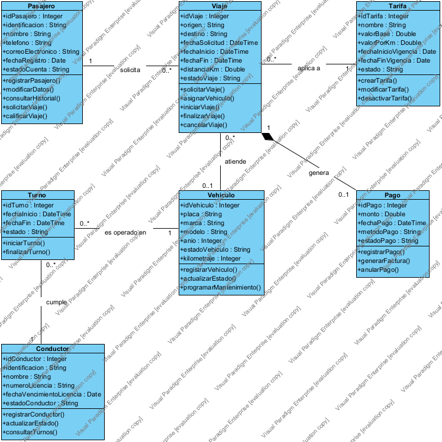
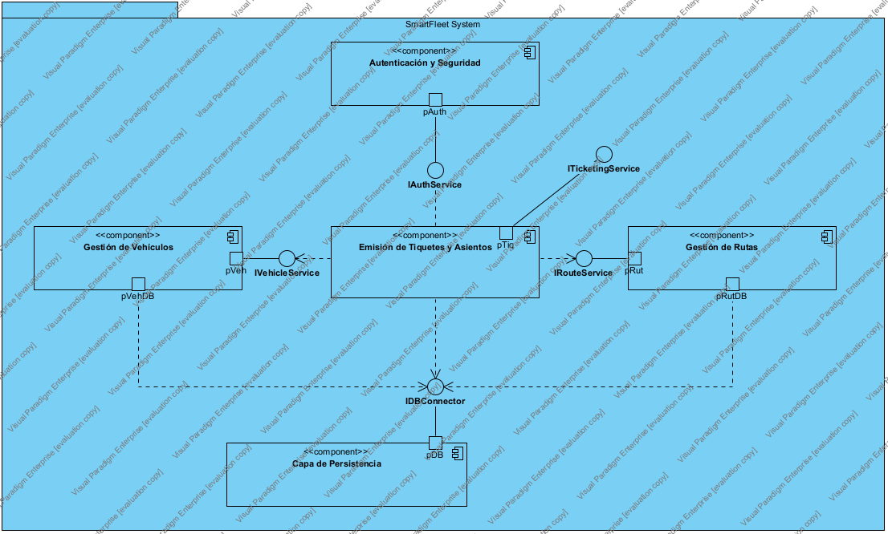
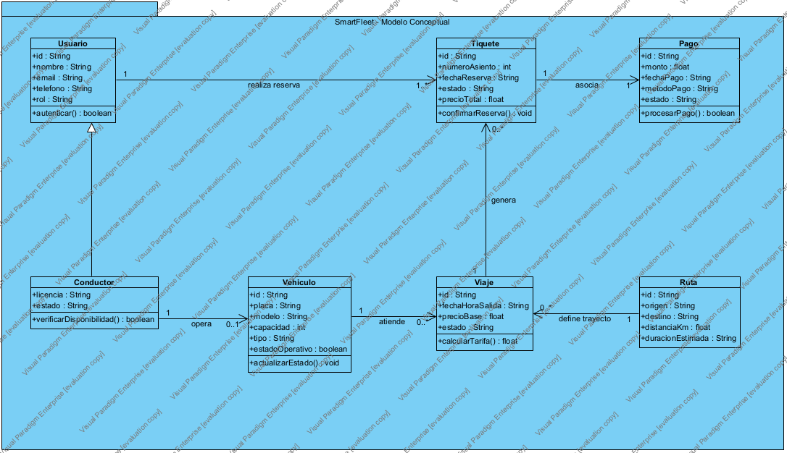

# SmartFlet — Sistema de gestión de flota de taxis

> **Estado:** En planificación. El repositorio contiene la documentación inicial; el código aún no ha sido desarrollado.
> Las secciones marcadas como **(propuesta)** son decisiones de diseño tentativas que se confirmarán durante la fase de análisis.

---

## Tabla de contenido

1. [Descripción general](#1-descripción-general)
2. [Alcance del proyecto](#2-alcance-del-proyecto)
3. [Tecnologías y arquitectura](#3-tecnologías-y-arquitectura)
4. [Instalación, configuración y ejecución](#4-instalación-configuración-y-ejecución)
5. [Estructura de directorios y componentes principales](#5-estructura-de-directorios-y-componentes-principales)
6. [Historias de usuario](#6-historias-de-usuario)
7. [Requerimientos funcionales](#7-requerimientos-funcionales)
8. [Diagramas UML](#8-diagramas-uml)

---

## 1. Descripción general

**SmartFlet** es una plataforma para administrar una flota de taxis de forma centralizada. Permite a la empresa registrar sus vehículos y conductores, asignar viajes a los taxis disponibles, seguir su ubicación en tiempo real, controlar turnos y mantenimiento, y consultar indicadores de operación.

### Propósito

- Reducir los tiempos de espera de los pasajeros mediante la asignación automática o manual del taxi más cercano disponible.
- Dar a la central de operaciones visibilidad en tiempo real del estado de cada vehículo.
- Llevar un registro confiable de viajes, kilometraje, ingresos y mantenimiento para la toma de decisiones.

### Usuarios y roles

| Rol | Descripción |
|---|---|
| **Administrador** | Gestiona vehículos, conductores, tarifas y usuarios del sistema. Consulta reportes completos. |
| **Operador de central** | Recibe solicitudes de viaje, asigna taxis y supervisa la flota en tiempo real. |
| **Conductor** | Recibe asignaciones, reporta su estado (disponible, ocupado, fuera de servicio) y cierra viajes. |
| **Pasajero** | Solicita un taxi y consulta el estado y la ubicación de su viaje. |

---

## 2. Alcance del proyecto

### Incluido en la versión inicial (MVP)

- Registro y autenticación de usuarios con roles.
- Gestión de vehículos y conductores.
- Solicitud, asignación y seguimiento de viajes.
- Seguimiento de ubicación de la flota en un mapa.
- Historial de viajes y reportes básicos.

### Fuera del alcance del MVP

- Procesamiento de pagos con tarjeta (se registrará solo el monto cobrado).
- Aplicaciones nativas para iOS y Android.
- Integración con sistemas de facturación electrónica del gobierno.
- Optimización avanzada de rutas con tráfico predictivo.

---

## 3. Tecnologías y arquitectura

> **(propuesta)** Stack tentativo, alineado con la experiencia del equipo en Java.

### Tecnologías

| Capa | Tecnología propuesta | Motivo |
|---|---|---|
| Lenguaje principal (backend) | Java 26 | Lenguaje principal del equipo; JDK ya instalado en el entorno. |
| Frontend web | HTML, CSS y JavaScript | Interfaz de central y de conductor desde navegador, sin instalación. |
| Base de datos | PostgreSQL | Relacional, robusta y con soporte para datos geoespaciales (PostGIS). |
| Mapas y geolocalización | API de mapas (por definir) | Visualización de la flota y cálculo de distancias. |
| Control de versiones | Git y GitHub | Repositorio oficial del proyecto. |

### Arquitectura

> **(propuesta)** Arquitectura en capas con API REST, orientada a eventos para la ubicación en tiempo real.

```
┌──────────────────────────────────────────────────────────┐
│ Clientes: Web de central · App/Web de conductor · Pasajero│
└───────────────┬──────────────────────────┬───────────────┘
                │ HTTP/REST                │ WebSocket
┌───────────────▼──────────────────────────▼───────────────┐
│                    Backend (Java)                         │
│  Controladores REST ─ Servicios de negocio ─ Repositorios │
│  Módulo de despacho · Módulo de ubicación · Módulo de     │
│  reportes                                                 │
└───────────────────────────┬──────────────────────────────┘
                            │ JDBC
                  ┌─────────▼─────────┐
                  │    PostgreSQL     │
                  └───────────────────┘
```

Principios de diseño:

- **Separación por capas:** controladores, servicios de negocio y acceso a datos.
- **Dominio independiente de la infraestructura:** las reglas de asignación no dependen de la base de datos ni del framework web.
- **Ubicación en tiempo real:** los conductores envían su posición periódicamente; la central la recibe por WebSocket.

---

## 4. Instalación, configuración y ejecución

> El código aún no existe; esta guía se completará cuando se publique la primera versión ejecutable. Los pasos siguientes describen el flujo previsto.

### 4.1 Requisitos previos

- **Git** para clonar el repositorio.
- **JDK 26** (o la versión LTS que se confirme en el análisis).
- **PostgreSQL 16** o superior.
- **Node.js** (solo si el frontend usa herramientas de construcción).
- Un navegador moderno (Chrome, Edge o Firefox).

### 4.2 Obtener el código

```bash
git clone https://github.com/GUERRREROALEXANDER/flota-de-taxis-SmartFlet.git
cd flota-de-taxis-SmartFlet
```

### 4.3 Configuración (previsto)

1. Crear la base de datos:
   ```sql
   CREATE DATABASE smartflet;
   ```
2. Copiar el archivo de ejemplo de variables de entorno y completar los valores:
   ```bash
   cp .env.example .env
   ```
   Variables previstas:

   | Variable | Descripción | Ejemplo |
   |---|---|---|
   | `DB_URL` | Cadena de conexión a PostgreSQL | `jdbc:postgresql://localhost:5432/smartflet` |
   | `DB_USER` | Usuario de la base de datos | `smartflet` |
   | `DB_PASSWORD` | Contraseña de la base de datos | *(no versionar)* |
   | `JWT_SECRET` | Clave para firmar los tokens de sesión | *(no versionar)* |
   | `SERVER_PORT` | Puerto del servidor HTTP | `8080` |

3. Aplicar las migraciones de base de datos (se definirá la herramienta en el análisis técnico).

### 4.4 Ejecución (previsto)

```bash
# Backend
./mvnw spring-boot:run        # o el comando equivalente del build elegido

# Pruebas
./mvnw test
```

La aplicación quedará disponible en `http://localhost:8080`.

---

## 5. Estructura de directorios y componentes principales

> **(propuesta)** Estructura inicial; puede ajustarse durante el desarrollo.

```
flota-de-taxis-SmartFlet/
├── README.md
├── .env.example               # Variables de entorno de ejemplo (sin secretos)
├── docs/
│   ├── historias-de-usuario.md
│   ├── requerimientos-funcionales.md
│   └── diagramas/             # Diagramas de arquitectura y de secuencia
├── backend/
│   ├── src/main/java/smartflet/
│   │   ├── api/               # Controladores REST y DTOs
│   │   ├── dominio/           # Entidades y reglas de negocio (vehículo, viaje, conductor)
│   │   ├── servicio/          # Casos de uso: asignación, seguimiento, reportes
│   │   ├── persistencia/      # Repositorios y acceso a PostgreSQL
│   │   ├── ubicacion/         # Recepción y difusión de posiciones en tiempo real
│   │   └── seguridad/         # Autenticación, roles y tokens
│   ├── src/main/resources/
│   │   └── db/migracion/      # Scripts de migración
│   └── src/test/java/         # Pruebas unitarias y de integración
└── frontend/
    ├── central/               # Panel del operador de central
    ├── conductor/             # Vista del conductor
    └── pasajero/              # Vista para solicitar taxi
```

### Componentes principales

| Componente | Responsabilidad |
|---|---|
| **Gestión de flota** | Alta, edición y baja de vehículos; estado operativo y documentación. |
| **Gestión de conductores** | Registro de conductores, turnos y disponibilidad. |
| **Despacho de viajes** | Recibe solicitudes, busca el taxi disponible más cercano y gestiona la asignación. |
| **Ubicación en tiempo real** | Recibe las posiciones de los taxis y las muestra en el mapa de la central. |
| **Tarifas y facturación** | Cálculo del precio del viaje según distancia, tiempo y tarifa vigente. |
| **Reportes** | Indicadores de viajes, kilometraje, ingresos y mantenimiento. |
| **Seguridad** | Autenticación, control de acceso por rol y auditoría de acciones. |

---

## 6. Historias de usuario

Formato: *Como [rol], quiero [funcionalidad], para [beneficio/valor].*

### Épica A — Gestión de flota

**HU-01 — Registrar vehículos**
Como **administrador**, quiero registrar los datos de cada taxi (placa, modelo, año, número interno), para tener un inventario actualizado de la flota.

- [ ] La placa es única; el sistema rechaza un registro con una placa existente.
- [ ] Todos los campos obligatorios se validan antes de guardar.
- [ ] El vehículo queda en estado "fuera de servicio" hasta que se active.

**HU-02 — Registrar conductores**
Como **administrador**, quiero registrar a los conductores con su licencia y datos de contacto, para controlar quién puede operar cada taxi.

- [ ] No se permite registrar un conductor con licencia vencida.
- [ ] Un conductor solo puede estar asignado a un vehículo activo a la vez.
- [ ] Se puede desactivar un conductor sin borrar su historial.

**HU-03 — Controlar turnos**
Como **administrador**, quiero asignar turnos a los conductores, para cubrir la operación en los horarios de mayor demanda.

- [ ] Un turno tiene fecha de inicio, fecha de fin y vehículo asociado.
- [ ] El sistema avisa si dos turnos se solapan para el mismo conductor o vehículo.
- [ ] El conductor puede consultar sus turnos programados.

### Épica B — Despacho de viajes

**HU-04 — Solicitar un taxi**
Como **pasajero**, quiero solicitar un taxi indicando mi punto de recogida, para llegar a mi destino sin tener que buscar un vehículo.

- [ ] La solicitud requiere punto de recogida válido dentro del área de servicio.
- [ ] Se muestra el tiempo estimado de llegada antes de confirmar.
- [ ] El pasajero recibe una confirmación con un identificador de viaje.

**HU-05 — Asignar automáticamente el taxi más cercano**
Como **operador de central**, quiero que el sistema asigne el taxi disponible más cercano a cada solicitud, para reducir el tiempo de espera del pasajero.

- [ ] Solo se consideran taxis en estado "disponible" con conductor activo.
- [ ] Si no hay taxis disponibles, la solicitud queda en cola y se notifica a la central.
- [ ] La asignación queda registrada con fecha, hora y vehículo.

**HU-06 — Asignar manualmente un taxi**
Como **operador de central**, quiero asignar manualmente un taxi a una solicitud, para atender casos especiales o emergencias.

- [ ] Solo se pueden asignar vehículos disponibles.
- [ ] La asignación manual queda marcada con el usuario que la realizó.
- [ ] Se puede reasignar un viaje mientras el taxi no haya recogido al pasajero.

**HU-07 — Responder a una asignación**
Como **conductor**, quiero recibir y aceptar o rechazar las asignaciones, para indicar si estoy en condiciones de atender el viaje.

- [ ] La asignación aparece en la app del conductor con datos de recogida.
- [ ] Si el conductor no responde en un tiempo límite, la asignación pasa al siguiente taxi.
- [ ] El estado del conductor cambia a "ocupado" al aceptar.

**HU-08 — Cerrar un viaje**
Como **conductor**, quiero marcar el inicio y el fin del viaje, para que el sistema registre la duración, distancia y tarifa correctas.

- [ ] Los estados del viaje siguen el orden: asignado → en curso → finalizado.
- [ ] Al finalizar, se calcula el precio según la tarifa vigente.
- [ ] El conductor vuelve a estado "disponible" al cerrar el viaje.

### Épica C — Seguimiento y control

**HU-09 — Ver la flota en tiempo real**
Como **operador de central**, quiero ver en un mapa la ubicación y el estado de cada taxi, para tomar decisiones de despacho rápidamente.

- [ ] El mapa se actualiza al menos cada 10 segundos.
- [ ] Cada taxi se muestra con un color según su estado.
- [ ] Al hacer clic en un taxi se muestra su conductor, viaje actual y última posición.

**HU-10 — Consultar el estado del viaje**
Como **pasajero**, quiero ver el estado y la ubicación de mi taxi, para saber cuánto falta para que llegue.

- [ ] El estado del viaje se actualiza sin recargar la página.
- [ ] Se muestra la hora estimada de llegada.
- [ ] Si el viaje se reasigna, el pasajero recibe una notificación.

**HU-11 — Registrar mantenimiento**
Como **administrador**, quiero registrar los mantenimientos de cada vehículo, para anticipar fallas y cumplir con la normativa.

- [ ] Cada mantenimiento registra fecha, tipo, costo y kilometraje.
- [ ] El sistema alerta cuando un vehículo supera el kilometraje límite de mantenimiento.
- [ ] Un vehículo en mantenimiento no puede ser asignado a viajes.

### Épica D — Reportes y administración

**HU-12 — Consultar reportes de operación**
Como **administrador**, quiero consultar reportes de viajes, kilometraje e ingresos por período, para evaluar el desempeño de la flota.

- [ ] Los reportes se pueden filtrar por fecha, vehículo y conductor.
- [ ] Los reportes se pueden exportar en formato CSV.
- [ ] Los totales del reporte coinciden con el detalle de viajes.

**HU-13 — Administrar tarifas**
Como **administrador**, quiero definir y modificar las tarifas, para ajustar los precios sin cambiar el código.

- [ ] Una tarifa tiene vigencia de fecha de inicio y fin.
- [ ] Los viajes ya finalizados conservan la tarifa con la que se cobraron.
- [ ] No pueden existir dos tarifas vigentes en el mismo horario.

**HU-14 — Iniciar sesión con roles**
Como **usuario del sistema**, quiero iniciar sesión con mi cuenta, para acceder solo a las funciones de mi rol.

- [ ] El acceso se valida con usuario y contraseña; las contraseñas se almacenan cifradas.
- [ ] Un usuario sin permiso recibe un error 403 al intentar acceder a una función restringida.
- [ ] La sesión expira tras un período de inactividad configurable.

---

## 7. Requerimientos funcionales

Prioridad según la escala **MoSCoW**: **Alta** (imprescindible para el MVP), **Media** (importante, puede postergarse), **Baja** (deseable).

### 7.1 Gestión de flota y conductores

| ID | Nombre | Descripción detallada | Prioridad |
|---|---|---|---|
| RF-01 | Registrar vehículo | El sistema debe permitir registrar un vehículo con placa, marca, modelo, año y número interno. La placa debe ser única. | Alta |
| RF-02 | Consultar y editar vehículo | El sistema debe permitir listar, buscar, editar y dar de baja lógica un vehículo. | Alta |
| RF-03 | Registrar conductor | El sistema debe permitir registrar un conductor con nombre, documento, número de licencia y fecha de vencimiento de la licencia. | Alta |
| RF-04 | Gestionar turnos | El sistema debe permitir programar turnos asociando conductor y vehículo, validando solapamientos. | Media |
| RF-05 | Registrar mantenimiento | El sistema debe registrar mantenimientos por vehículo y bloquear la asignación de vehículos en mantenimiento. | Media |

**Alcance:** Cubre el inventario de la flota y de los conductores. Es el punto de partida de los demás módulos, ya que sin vehículos y conductores activos no es posible despachar viajes. Los registros se desactivan de forma lógica para conservar el historial.

### 7.2 Solicitud y despacho de viajes

| ID | Nombre | Descripción detallada | Prioridad |
|---|---|---|---|
| RF-06 | Solicitar viaje | El sistema debe permitir crear una solicitud de viaje con punto de recogida y, opcionalmente, destino. | Alta |
| RF-07 | Asignar taxi automáticamente | El sistema debe asignar el taxi disponible más cercano al punto de recogida, considerando solo vehículos activos con conductor disponible. | Alta |
| RF-08 | Asignar taxi manualmente | El operador de central debe poder asignar o reasignar un taxi disponible a una solicitud. | Alta |
| RF-09 | Aceptar o rechazar asignación | El conductor debe poder aceptar o rechazar una asignación. Tras un tiempo límite sin respuesta, el sistema debe reasignar el viaje. | Alta |
| RF-10 | Gestionar estados del viaje | El sistema debe controlar los estados: solicitado, asignado, en curso, finalizado y cancelado, sin permitir transiciones inválidas. | Alta |
| RF-11 | Cancelar viaje | El sistema debe permitir cancelar un viaje antes de que inicie, registrando el motivo y quién lo canceló. | Media |

**Alcance:** Describe el flujo completo desde que el pasajero solicita un taxi hasta que el viaje termina. La asignación automática es el comportamiento principal; la manual sirve como respaldo para la central. Cada cambio de estado debe quedar registrado con fecha, hora y usuario responsable.

### 7.3 Ubicación y seguimiento

| ID | Nombre | Descripción detallada | Prioridad |
|---|---|---|---|
| RF-12 | Enviar ubicación del taxi | La app del conductor debe enviar su posición (latitud, longitud, velocidad) cada 10 segundos mientras esté en servicio. | Alta |
| RF-13 | Visualizar flota en mapa | El panel de central debe mostrar en un mapa la posición y el estado de cada taxi, con actualización automática. | Alta |
| RF-14 | Consultar estado del viaje | El pasajero debe poder consultar el estado de su viaje y la ubicación aproximada del taxi asignado. | Media |
| RF-15 | Notificar eventos | El sistema debe notificar a los usuarios afectados ante asignación, reasignación, llegada del taxi o cancelación. | Media |

**Alcance:** Garantiza la visibilidad de la operación en tiempo real. La frecuencia de envío de ubicación es un parámetro configurable; el valor por defecto equilibra precisión y consumo de datos del dispositivo.

### 7.4 Tarifas, reportes y seguridad

| ID | Nombre | Descripción detallada | Prioridad |
|---|---|---|---|
| RF-16 | Calcular tarifa del viaje | El sistema debe calcular el precio del viaje a partir de distancia, tiempo y la tarifa vigente en la fecha del viaje. | Alta |
| RF-17 | Administrar tarifas | El administrador debe poder crear, modificar y desactivar tarifas con vigencia definida. | Media |
| RF-18 | Generar reportes | El sistema debe generar reportes de viajes, kilometraje e ingresos filtrables por período, vehículo y conductor, con exportación a CSV. | Media |
| RF-19 | Autenticación y roles | El sistema debe autenticar usuarios con usuario y contraseña, y restringir las funciones según el rol (administrador, operador, conductor, pasajero). | Alta |
| RF-20 | Registro de auditoría | El sistema debe registrar las acciones sensibles (asignaciones manuales, cambios de tarifa, altas y bajas) con usuario, fecha y hora. | Baja |

**Alcance:** Agrupa las reglas económicas, la información para la toma de decisiones y los controles de acceso. La tarifa vigente debe quedar fijada en cada viaje para que los cambios futuros no alteren los cobros pasados.

---

## 8. Diagramas UML

Modelados en Visual Paradigm 18.1. Cada diagrama tiene su carpeta en [`docs/diagramas/`](docs/diagramas/) con el `.puml`, el `.png`, el `.vpp` y un README con las decisiones de diseño. El proyecto completo con los tres diagramas es [`smartflet-diagramas.vpp`](docs/diagramas/smartflet-diagramas.vpp).

| # | Diagrama | PNG | VPP |
|---|---|---|---|
| 01 | Clases de dominio | [smartflet-clases-dominio-vp.png](docs/diagramas/01-clases-dominio/smartflet-clases-dominio-vp.png) | [smartflet-clases-dominio.vpp](docs/diagramas/01-clases-dominio/smartflet-clases-dominio.vpp) |
| 02 | Componentes | [smartflet-componentes.png](docs/diagramas/02-componentes/smartflet-componentes.png) | [smartflet-componentes.vpp](docs/diagramas/02-componentes/smartflet-componentes.vpp) |
| 03 | Modelo conceptual y de dominio | [smartflet-modelo-conceptual.png](docs/diagramas/03-modelo-conceptual/smartflet-modelo-conceptual.png) | [smartflet-modelo-conceptual.vpp](docs/diagramas/03-modelo-conceptual/smartflet-modelo-conceptual.vpp) |

### 01 — Clases de dominio


### 02 — Componentes


### 03 — Modelo conceptual y de dominio


---

## Licencia

Por definir.
