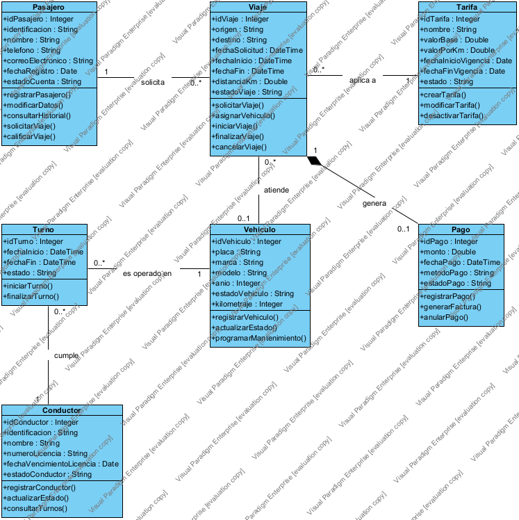
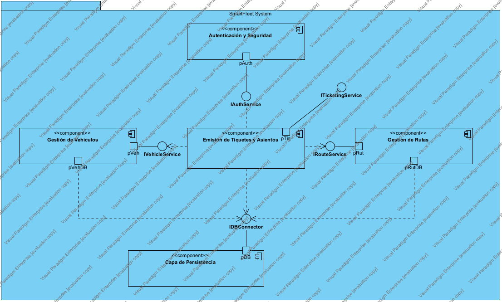
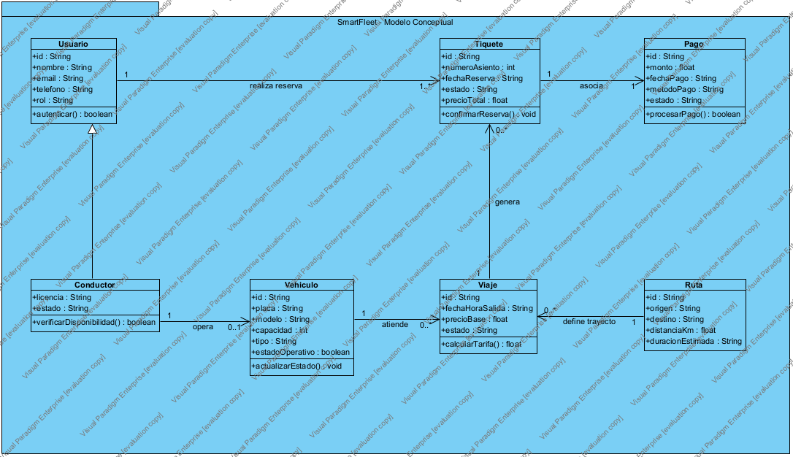

# Diagramas UML — SmartFleet

Índice de los diagramas de modelado del sistema. Cada diagrama vive en su propia carpeta numerada, con el `.puml`, el render y un `README.md` propio con las decisiones de diseño.

## Proyecto de Visual Paradigm

Todos los diagramas están modelados en un solo proyecto: [`smartflet-diagramas.vpp`](smartflet-diagramas.vpp) (Visual Paradigm 18.1). Los PNG de cada carpeta son exportaciones de ese proyecto.

## Convención

- Carpeta: `NN-nombre-corto/` (dos dígitos + nombre descriptivo en minúsculas).
- Dentro: `smartflet-<nombre>.puml`, `smartflet-<nombre>.png`, `README.md`.
- Los `.puml` son autocontenidos (sin `!include` ni `!define`) para poder importarlos en Visual Paradigm u otra herramienta.

## Diagramas

| # | Diagrama | Carpeta | PNG | VPP | Estado |
|---|---|---|---|---|---|
| 01 | Clases de dominio | [`01-clases-dominio/`](01-clases-dominio/) | [PNG](01-clases-dominio/smartflet-clases-dominio-vp.png) | [VPP](01-clases-dominio/smartflet-clases-dominio.vpp) | ✅ Hecho |
| 02 | Componentes | [`02-componentes/`](02-componentes/) | [PNG](02-componentes/smartflet-componentes.png) | [VPP](02-componentes/smartflet-componentes.vpp) | ✅ Hecho |
| 03 | Modelo conceptual y de dominio | [`03-modelo-conceptual/`](03-modelo-conceptual/) | [PNG](03-modelo-conceptual/smartflet-modelo-conceptual.png) | [VPP](03-modelo-conceptual/smartflet-modelo-conceptual.vpp) | ✅ Hecho |

Cada `.vpp` de carpeta contiene solo su diagrama; `smartflet-diagramas.vpp` los reúne a los tres.

## Vista previa

### 01 — Clases de dominio

### 02 — Componentes

### 03 — Modelo conceptual y de dominio

