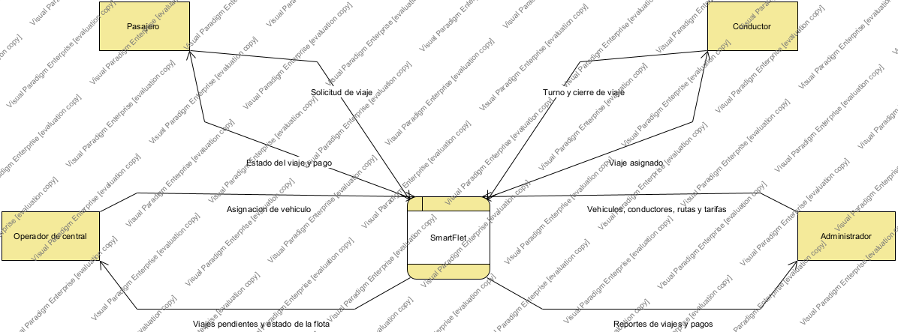
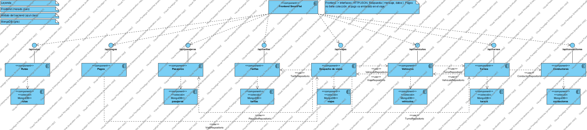
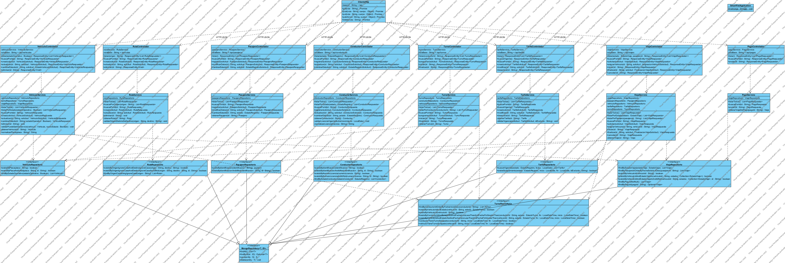
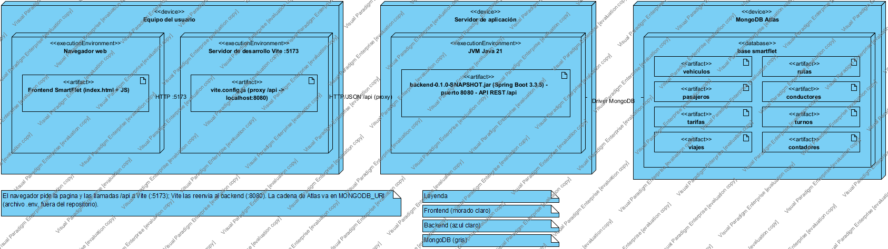

# Vistas de arquitectura — SmartFlet

Las cinco vistas están en un solo proyecto de Visual Paradigm 18.1: [`smartflet-diagramas.vpp`](smartflet-diagramas.vpp). Se hicieron a partir del código actual (backend Spring Boot 3.3.5 + MongoDB). Los PNG de cada carpeta son exportaciones de ese proyecto.

| # | Vista | Diagrama | PNG |
|---|---|---|---|
| 1 | Contexto | Diagrama de contexto (DFD nivel 0) | [vista-contexto.png](1-vista-contexto/vista-contexto.png) |
| 2 | Funcional | Diagrama de componentes | [vista-funcional.png](2-vista-funcional/vista-funcional.png) |
| 3 | Lógica | Diagrama de clases con estereotipos GRASP | [vista-logica.png](3-vista-logica/vista-logica.png) |
| 4 | Desarrollo | Diagrama de clases por capas | [vista-desarrollo.png](4-vista-desarrollo/vista-desarrollo.png) |
| 5 | Despliegue | Diagrama de despliegue | [vista-despliegue.png](5-vista-despliegue/vista-despliegue.png) |

Las marcas de agua "evaluation copy" las pone la licencia de evaluación de Visual Paradigm.

## 1 — Vista de contexto
SmartFlet como un solo proceso y los cuatro roles que le envían y reciben información.

## 2 — Vista funcional
Siete componentes funcionales, cada uno con su colección en MongoDB. Las interfaces (bola) son los servicios que un módulo ofrece a otro; la línea `<<use>>` indica quién los pide.

## 3 — Vista lógica
Clases del dominio con su patrón GRASP: `<<Experto>>`, `<<Creador>>`, `<<Controlador>>` y `<<Fabricación pura>>`.

## 4 — Vista de desarrollo
El código por capas: `ClienteHttp` (frontend) → controladores → servicios → repositorios → `MongoRepository`.

## 5 — Vista de despliegue
Tres nodos: el equipo del usuario con el navegador, el servidor de aplicación con la JVM y el `.jar`, y el servidor de MongoDB.

