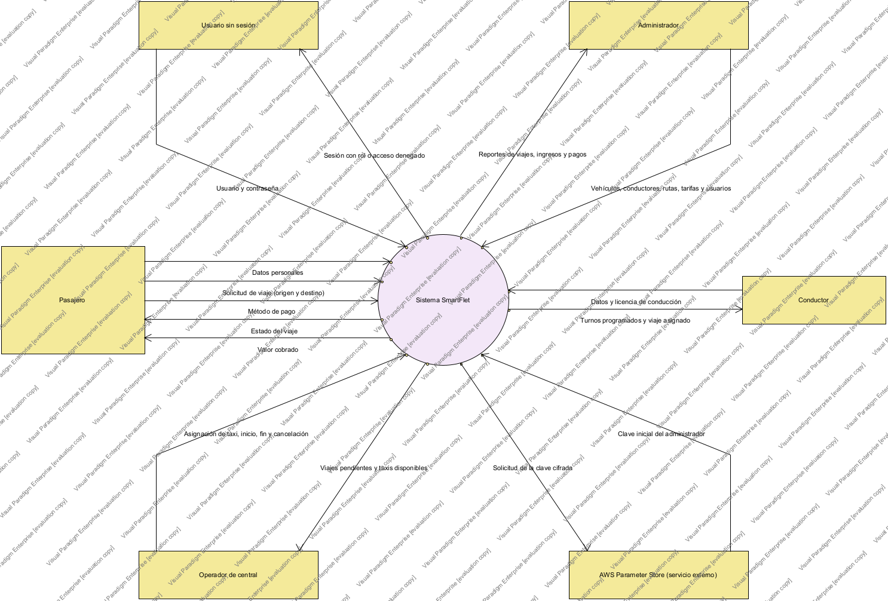
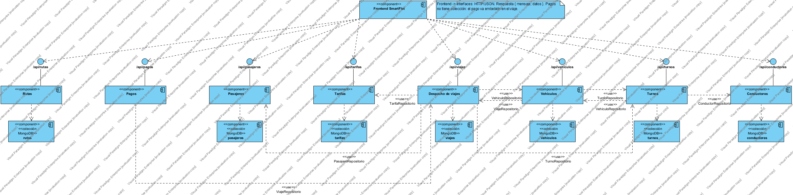
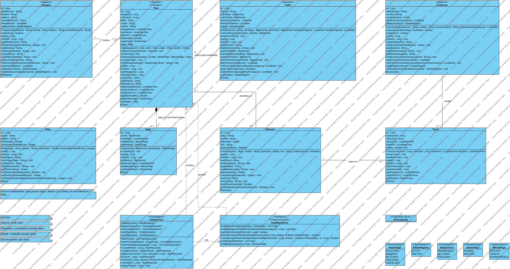
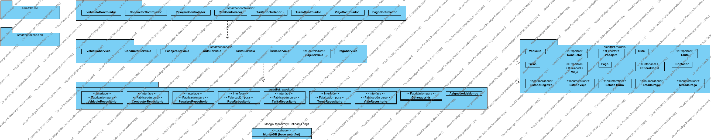

# Vistas de arquitectura — SmartFlet

Las cinco vistas están en un solo proyecto de Visual Paradigm 18.1: [`visual-paradigm/smartflet-diagramas.vpp`](visual-paradigm/smartflet-diagramas.vpp). Siguen el formato de la presentación de diseño del curso y se hicieron a partir del código de la rama `feature/login-y-despliegue-aws`: backend Spring Boot + MongoDB, con inicio de sesión por roles y despliegue en AWS EC2. Los PNG de `imagenes/` son exportaciones de ese proyecto.

| # | Vista | Diagrama | PNG |
|---|---|---|---|
| 1 | Contexto | Diagrama de contexto (DFD nivel 0) | [vista-contexto.png](imagenes/1-vista-contexto/vista-contexto.png) |
| 2 | Funcional | Diagrama de componentes | [vista-funcional.png](imagenes/2-vista-funcional/vista-funcional.png) |
| 3 | Lógica | Diagrama de clases con estereotipos GRASP | [vista-logica.png](imagenes/3-vista-logica/vista-logica.png) |
| 4 | Desarrollo | Diagrama de clases por capas (paquetes) | [vista-desarrollo.png](imagenes/4-vista-desarrollo/vista-desarrollo.png) |
| 5 | Despliegue | Diagrama de despliegue | [vista-despliegue.png](imagenes/5-vista-despliegue/vista-despliegue.png) |

Las marcas de agua "evaluation copy" las pone la licencia de evaluación de Visual Paradigm.

**Presentación:** [`../presentacion/SmartFlet_Presentacion_Diseno.pptx`](../presentacion/SmartFlet_Presentacion_Diseno.pptx) reúne las cinco vistas en este mismo orden. Cada diapositiva lleva notas del orador.

## 1 — Vista de contexto
SmartFlet es un único proceso. A su alrededor están las seis entidades externas que le envían y reciben información:
- el usuario sin sesión, que inicia sesión;
- el administrador, el pasajero, el conductor y el operador de central;
- AWS Parameter Store, de donde sale la clave inicial del administrador.

Cada flujo de datos lleva el nombre de lo que viaja por él, en ambos sentidos.

## 2 — Vista funcional
- El frontend consume por HTTP/JSON la interfaz `/api/...` (bola) de cada uno de los nueve módulos del backend.
- Las líneas `<<use>>` son las dependencias reales entre servicios. Por ejemplo, Viajes valida el pasajero, la tarifa vigente, el vehículo y su turno.
- Debajo de cada módulo está la colección de MongoDB que persiste. Pagos no tiene colección propia porque el pago va embebido en el viaje.
- Spring Security valida la sesión y el rol en cada petición; la nota del diagrama lo explica.

## 3 — Vista lógica
Muestra las clases del dominio con sus atributos privados, getters y setters, las enumeraciones y las asociaciones con su multiplicidad. Cada clase lleva su patrón GRASP:
- **Experto:** cada entidad.
- **Creador:** Viaje, que crea su Pago (composición).
- **Controlador:** `ViajeServicio`, que coordina el caso de uso principal.
- **Fabricación pura:** `ViajeRepositorio`, que persiste los viajes.

## 4 — Vista de desarrollo
Las capas del backend, con las clases y sus miembros:
- **Capas principales:** presentación (`controlador`, `<<RestController>>`) → negocio (`servicio`, `<<Service>>`) → datos (`repositorio`, interfaces que extienden `MongoRepository`) → base MongoDB.
- **Seguridad:** configuración de Spring Security, control de intentos y creación del administrador inicial.
- **Paquetes de apoyo:** `dto` y `excepcion`. El paquete `modelo` es el de la vista lógica.
- **Conexiones:** cada flecha va de la clase que usa a la dependencia que Spring le inyecta; el `1` es la multiplicidad (una instancia). Todos los repositorios heredan de `MongoRepository`.

## 5 — Vista de despliegue
El navegador del usuario carga la interfaz web y llama a la API por HTTP (puerto 80, que se redirige al 8080). La aplicación corre en un servidor AWS EC2 (Amazon Linux 2023, t3.micro, IP elástica) con Docker Compose y dos contenedores:
- `app`: JVM Java 21 con el `.jar` de Spring Boot, que también sirve el frontend.
- `mongo`: MongoDB 7, sin puerto público.

La clave inicial del administrador se lee cifrada de AWS Systems Manager Parameter Store.

