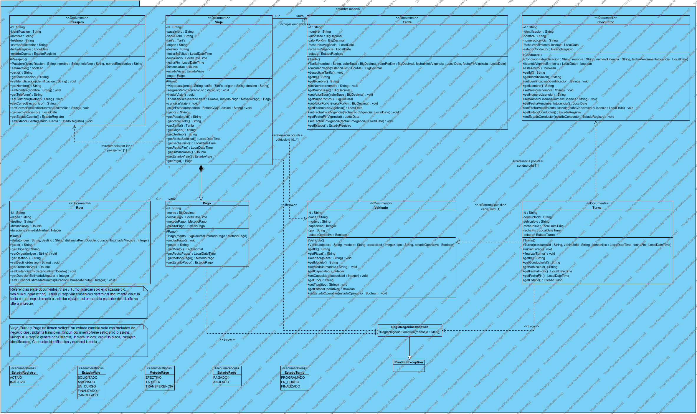
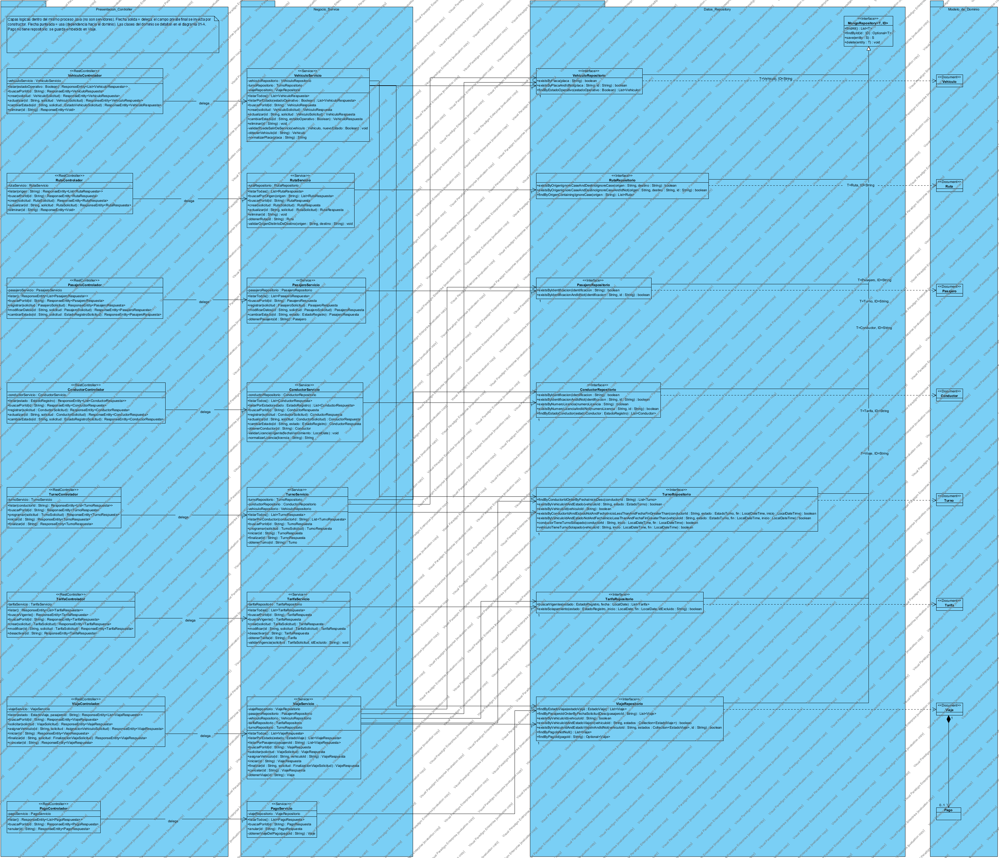
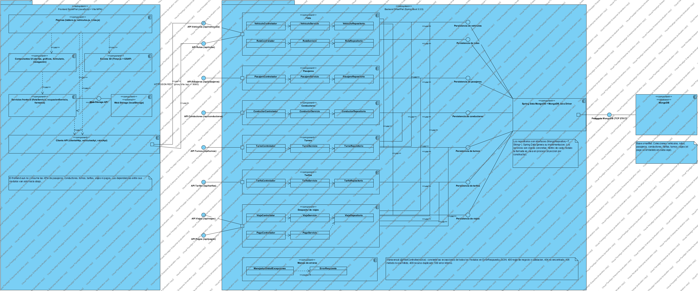
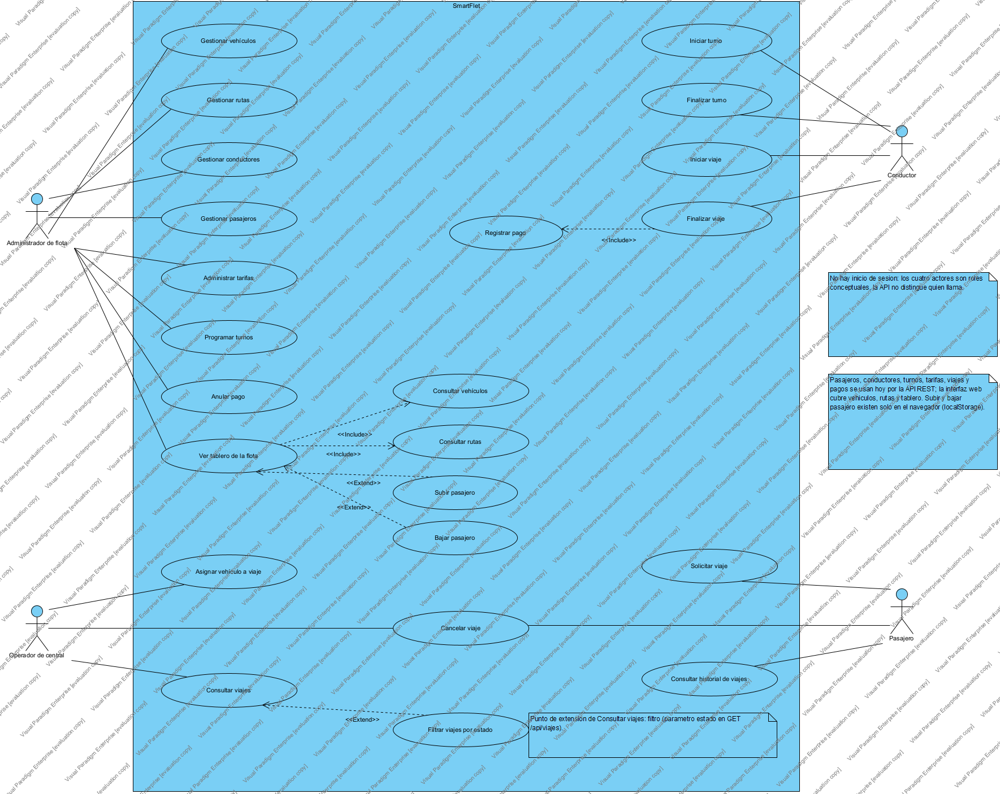
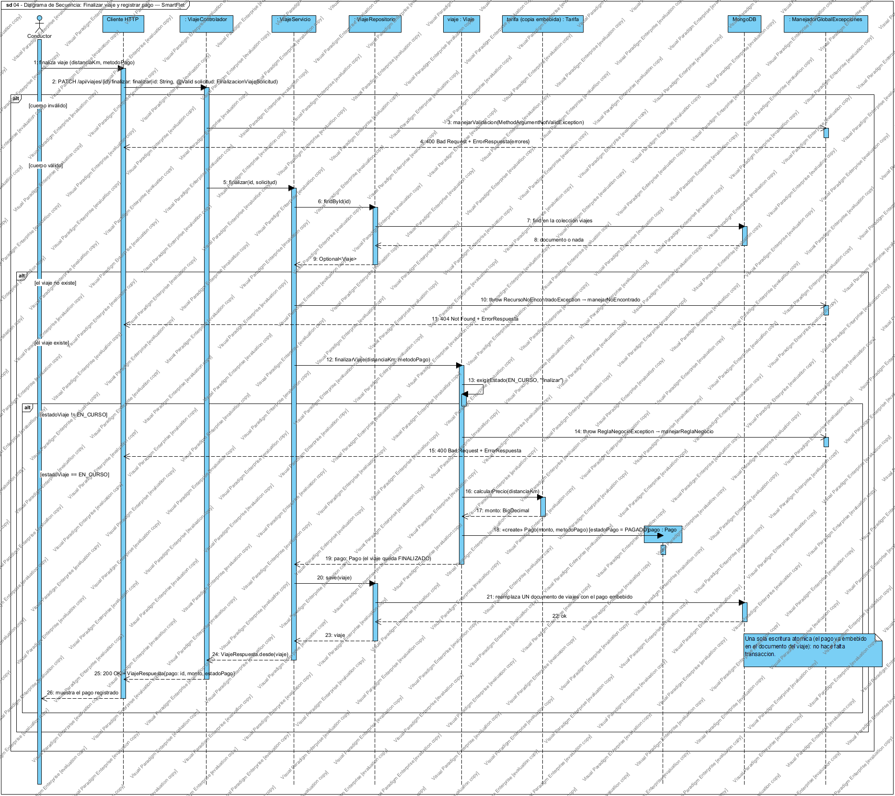
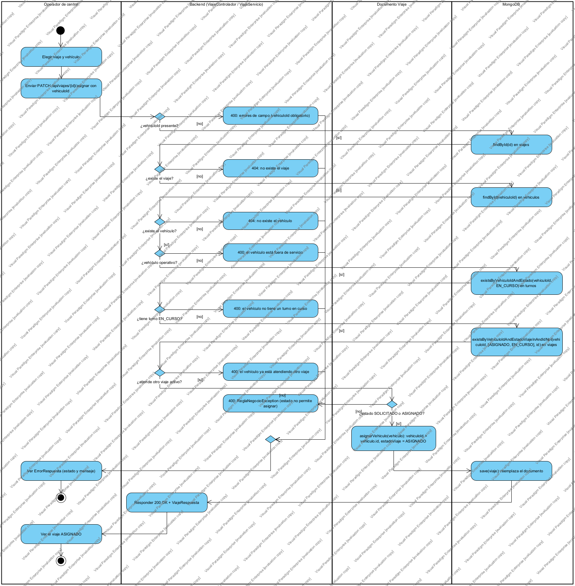
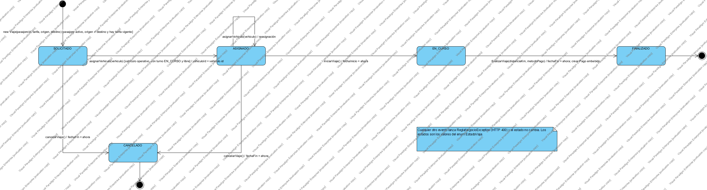
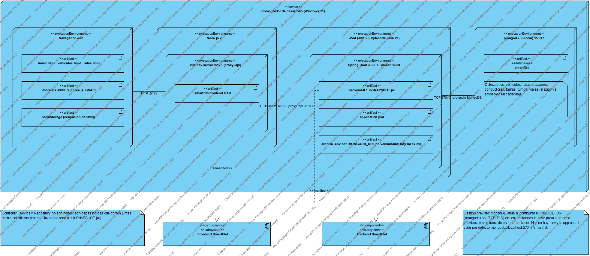

# Diagramas UML — SmartFlet

Todos los diagramas están en un solo proyecto de Visual Paradigm 18.1: [`smartflet-diagramas.vpp`](smartflet-diagramas.vpp). Se hicieron a partir del código actual (Spring Boot 3.3.5 + MongoDB, frontend con Vite). Los PNG de cada carpeta son exportaciones de ese proyecto.

| # | Diagrama | PNG |
|---|---|---|
| 01-A | Clases: dominio (8 documentos/clases, 5 enumeraciones, getters y setters reales) | [01A-clases-dominio.png](01-clases/01A-clases-dominio.png) |
| 01-B | Clases: arquitectura por capas (Controller → Service → Repository → Modelo) | [01B-arquitectura-capas.png](01-clases/01B-arquitectura-capas.png) |
| 02 | Componentes (frontend, backend por módulos, Spring Data MongoDB, MongoDB) | [02-componentes.png](02-componentes/02-componentes.png) |
| 03 | Casos de uso | [03-casos-de-uso.png](03-casos-de-uso/03-casos-de-uso.png) |
| 04 | Secuencia: finalizar viaje y registrar pago | [04-secuencia-finalizar-viaje.png](04-secuencia/04-secuencia-finalizar-viaje.png) |
| 05 | Actividades: asignar vehículo a un viaje | [05-actividades-asignar-vehiculo.png](05-actividades/05-actividades-asignar-vehiculo.png) |
| 06 | Máquina de estados: Viaje | [06-estados-viaje.png](06-estados-viaje/06-estados-viaje.png) |
| 07 | Despliegue (mongod local; destino previsto MongoDB Atlas) | [07-despliegue.png](07-despliegue/07-despliegue.png) |

## Notación usada

- **Clases:** `◆` composición (Viaje–Pago, Viaje–Tarifa como copia embebida); dependencia «referencia por id» cuando un documento guarda solo el id de otro; `«throw»` hacia `ReglaNegocioException`.
- **Capas:** flecha sólida = delega (campo `private final` inyectado por constructor); herencia de cada repositorio hacia `MongoRepository<T, ID>`.
- **Componentes:** bola = interfaz provista (Realization), flecha «use» = interfaz requerida, puertos en el borde de cada módulo.
- **Despliegue:** `«device»`, `«executionEnvironment»`, `«artifact»`, rutas de comunicación con protocolo y `«manifest»` hacia los subsistemas del 02.

Las marcas de agua "evaluation copy" las pone la licencia de evaluación de Visual Paradigm.

## Vista previa

### 01-A — Clases: dominio

### 01-B — Clases: arquitectura por capas

### 02 — Componentes

### 03 — Casos de uso

### 04 — Secuencia: finalizar viaje

### 05 — Actividades: asignar vehículo

### 06 — Estados del viaje

### 07 — Despliegue

