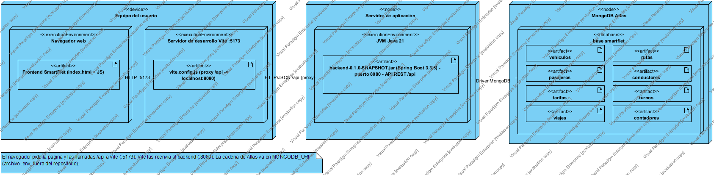

# Vistas de arquitectura — SmartFlet

Las cinco vistas están en un solo proyecto de Visual Paradigm 18.1: [`visual-paradigm/smartflet-diagramas.vpp`](visual-paradigm/smartflet-diagramas.vpp). Se hicieron a partir del código actual (backend Spring Boot 3.3.5 + MongoDB). Los PNG de `imagenes/` son exportaciones de ese proyecto. Las copias anteriores del proyecto están en `visual-paradigm/respaldos/`.

| # | Vista | Diagrama | PNG |
|---|---|---|---|
| 1 | Contexto | Diagrama de contexto (DFD nivel 0) | [vista-contexto.png](imagenes/1-vista-contexto/vista-contexto.png) |
| 2 | Funcional | Diagrama de componentes | [vista-funcional.png](imagenes/2-vista-funcional/vista-funcional.png) |
| 3 | Lógica | Diagrama de clases con estereotipos GRASP | [vista-logica.png](imagenes/3-vista-logica/vista-logica.png) |
| 4 | Desarrollo | Diagrama de paquetes | [vista-desarrollo.png](imagenes/4-vista-desarrollo/vista-desarrollo.png) |
| 5 | Despliegue | Diagrama de despliegue | [vista-despliegue.png](imagenes/5-vista-despliegue/vista-despliegue.png) |

Las marcas de agua "evaluation copy" las pone la licencia de evaluación de Visual Paradigm.

**Presentación:** [`../presentacion/SmartFlet_Presentacion_Diseno.pptx`](../presentacion/SmartFlet_Presentacion_Diseno.pptx) reúne las cinco vistas, en este mismo orden, con el formato de la presentación de diseño del curso. Cada diapositiva lleva notas del orador.

## 1 — Vista de contexto
SmartFlet como un solo proceso y los cuatro roles que le envían y reciben información; cada flujo nombra el endpoint REST que lo implementa.

## 2 — Vista funcional
Ocho módulos del backend, cada uno con su interfaz `/api/...` (bola) que consume el frontend por HTTP/JSON. Las líneas `<<use>>` son las dependencias reales entre servicios. Debajo de cada módulo está su colección de MongoDB; Pagos no tiene, porque el pago va embebido en el viaje.

## 3 — Vista lógica
Clases del dominio con su patrón GRASP: `<<Experto>>`, `<<Creador>>`, `<<Controlador>>` y `<<Fabricación pura>>`.

## 4 — Vista de desarrollo
Los paquetes del backend con el nombre de sus clases: controlador → servicio → repositorio → MongoDB; servicio y repositorio dependen de modelo. `dto` y `excepcion` van aparte.

## 5 — Vista de despliegue
Tres nodos: el equipo del usuario (navegador y servidor Vite :5173 con el proxy `/api`), el servidor de aplicación (JVM Java 21 con el `.jar` de Spring Boot en :8080) y MongoDB Atlas (base `smartflet` con 8 colecciones).

